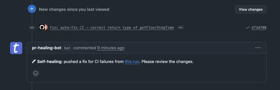

I built a GitHub Action that auto-fixes CI failures with Claude.

The idea came this morning while making breakfast for my daughter. Half-thinking about work, and then it clicked: why am I still manually fixing CI failures that an AI could handle on its own?

So I sat down and built a simple GitHub Action workflow:
→ CI fails on a pull request
→ Claude gets triggered automatically
→ It analyzes the failure, attempts a fix, and commits

That's it. No Slack notification to triage. No context switch. No "let me look at this later."

Did it require some setup? Yes — creating a GitHub App was the most tedious part. But with Claude's help, even that was straightforward.

Here's what I keep coming back to: the highest-leverage AI workflows aren't the ones where you prompt an assistant. They're the ones that remove you from the loop entirely for low-value tasks.

Linting issues, type errors, missing imports — these shouldn't interrupt your flow. They should just get fixed.

The future of developer experience isn't "AI helps you code."
It's "AI handles what shouldn't have needed your attention in the first place."

Here is a gist I bet you can just paste to Claude for quick implem: https://lnkd.in/eXgv4Bhp

#DevEx #Automation #AI #GitHubActions #BuildInPublic

