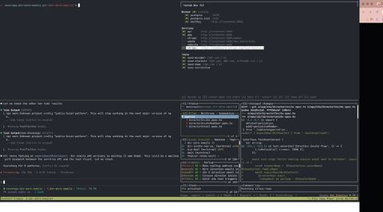

This week I realized I hadn't opened VSCode to write code in days. Claude Code was doing the writing. I was reviewing, directing, iterating.

So I went all in: Ghostty + tmux as my entire dev environment. No IDE. Just a terminal and AI.

Here's what makes it work — worktrunk (https://worktrunk.dev), a git worktree manager with lifecycle hooks.

On worktree creation, worktrunk automatically:
→ Runs pnpm install
→ Prepares a unique set of ports and .env variables so I can run multiple branches simultaneously with zero conflicts
→ Spins up a tmux window (named after the worktree) with 4 panes: shell, Claude Code, lazygit, and a homemade TUI for quick service monitoring

Every feature branch gets a full, isolated dev environment in seconds. And when the worktree is destroyed, worktrunk cleans up the tmux window automatically. Nothing lingers.

And the cherry on top: Claude Code updates the tmux window prefix with a status emoji depending on its state. One glance at my tmux bar tells me which branches need my attention — no context switching required.

VSCode? It still opens occasionally. To review diffs. That's it.

When AI writes your code, the IDE becomes overhead. You need speed, focus, and visibility.

The terminal gives you all three.

