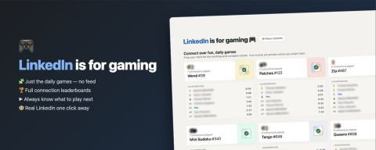

I'm thrilled to announce that I will never see your posts again. 🎉

Quick backstory: this morning I realized the only reason I open LinkedIn every single day is Queens. And Tango. And Zip. My streak is at 199 days. My feed reading streak is at 0.

So I did what any reasonable engineer would do instead of just closing the tab: I built a Chrome extension that deletes LinkedIn. Except the games.

LinkedIn is for Gaming:
🧩 Every LinkedIn page redirects straight to the puzzles — feed, notifications, "congratulate Random McStranger on 12 years at TrashFire Inc.", all gone
🏆 Full leaderboards right on the games page, so I can see exactly who beat me at Zip before 9am (I know it's you)
▶️ Highlights which game to play next, because that was somehow the hardest UX problem LinkedIn never solved
🐵 A "Show LinkedIn" button in case you miss it. You won't.

Free, open source, zero data collected:
⚙️ Code: https://lnkd.in/eBpvfcMz

🎮 Chrome Web Store: https://lnkd.in/e8fGPhkP

Yes, I'm aware of the irony of writing a LinkedIn post about a tool that removes LinkedIn posts. This is the last one you'll get.

So I guess you won't read from me ever again. 🫡

