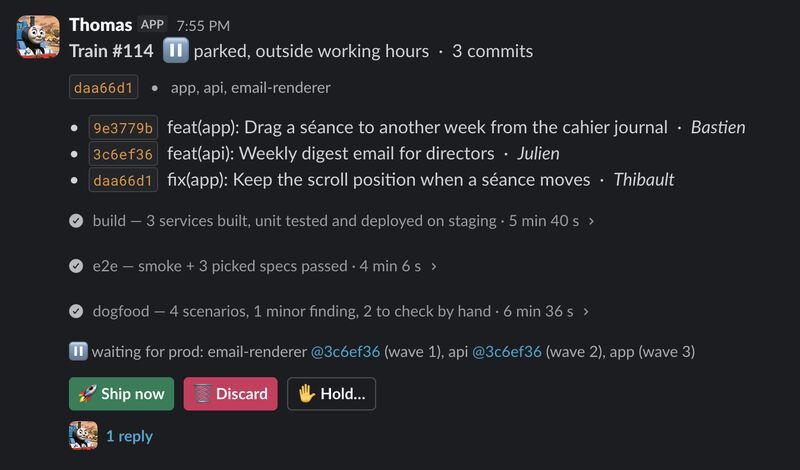

It took me three companies to ship to prod without anyone pressing the button.

Meet Thomas 🚂, the release train I built for Teetsh (yes, named after the tank engine).

Every team says it wants continuous deployment. Very few dare to let go for real. Trusting a pipeline enough to put code in front of users with no human approving it is mostly a matter of "lâcher prise", letting go.

Each time I rebuilt CI/CD I learned something, and each time I stopped one step short of fully automatic prod. At Teetsh, stopping short was no longer an option: with AI, and the tremendous work we've put into embracing the acceleration, commits shipped per day grew about tenfold in a year. No human approval keeps up with that. With Thomas I finally reached the holy grail: prod deploys that are fully automatic, safe and controlled.

Here's what happens after every merge:

🔨 **Build and staging.** A train leaves main with the waiting commits. Each service is built, unit tested and deployed on staging, then a smoke suite runs.

🎯 **AI picks the e2e tests.** It reads the diff and picks the tests that matter, on top of the smoke suite. Add sharding and parallel lanes, and the suite went from 40 minutes to about 11. Speed is half of trust: a train that waits an hour gets bypassed.

🧑‍🏫 **AI dogfoods.** An agent uses the app in a real browser, as a teacher would: it tries the new feature and reports what breaks. It also lists what it couldn't check (a tablet, a real mailbox) so a human knows where to look. About 10 minutes and $1.40 per train.

✋ **It raises its hand only when it matters.** Green ships to prod on its own, in dependency order. Red stops the train and pings the authors, and outside working hours the on-call dev gets pinged when the day starts. Anyone can put a hold, retry, or ship anyway with a written reason.

🎛️ **Two cockpits.** Slack for the team: buttons, threads, no dashboard to learn. tdev, our internal CLI (I should also write about this addition of mine), for developers and for AI agents, which can read and drive the train too.

"Trust and feedback rather than process" is a Teetsh value that our CEO Thibault lives by and protects. Thomas applies it to shipping: no approval gate and no release manager. Everything ships unless someone has a reason to stop it. AI doesn't replace that trust. It narrows the risk down to what deserves a human look, and it says so clearly. That's what made letting go possible.

A real example from this week: Valere wanted to validate a risky update by hand on staging. He put a hold from Slack, the trains kept being tested, and he released it when he was done. Prod picked up where it left off, with no ceremony.

The last point: I took Thomas from first commit to deploying prod in four days, and I've reshaped it every day since, based on what the team asked for. Today's change was fewer pings and shorter reports. When automation is this cheap to adapt, it follows the team instead of freezing it.
