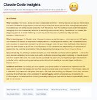

Just ran /insights on Claude Code — and honestly, everyone using it should do the same.

It analyzes your usage data locally and generates a full HTML report. Think of it as a retro on how you use AI-assisted coding.

Here's what mine looked like after 2 weeks:

- 285 sessions, ~4,900 messages
- 47 merged PRs in February (+34,026 additions, -7,483 deletions), yes they are big ones, making small ones creates unnecessary friction.
- Reports 31% of my messages happened in parallel sessions but this is actually innacurate, I always have several session in parallel, but I'm the bottleneck here, Claude is almost always waiting for my input in one of my tmux window. Need to work on this.

But the stats aren't even the best part.

The report breaks down what's working, what's not, and gives you concrete next steps. It caught that I was wasting ~10% of my sessions on a broken observer agent setup I kept retrying. It noticed Claude kept getting my API route prefixes wrong — and suggested the exact CLAUDE.md rules to fix it. It flagged sessions where Claude over-planned and never wrote code, and gave me a prompt template to prevent it.

It even suggests features you're not using yet. In my case: hooks to auto-run type checks after edits, custom skills for my PR workflow, and headless mode for CI auto-fixes.

The "On the Horizon" section is what got me most excited — it maps your current patterns to workflows that are becoming possible: autonomous test-driven implementation loops, parallel agents splitting backend and frontend work against a shared contract.
It's basically a personalized coaching session on how to get more out of Claude Code.

Run /insights. You'll learn something.

