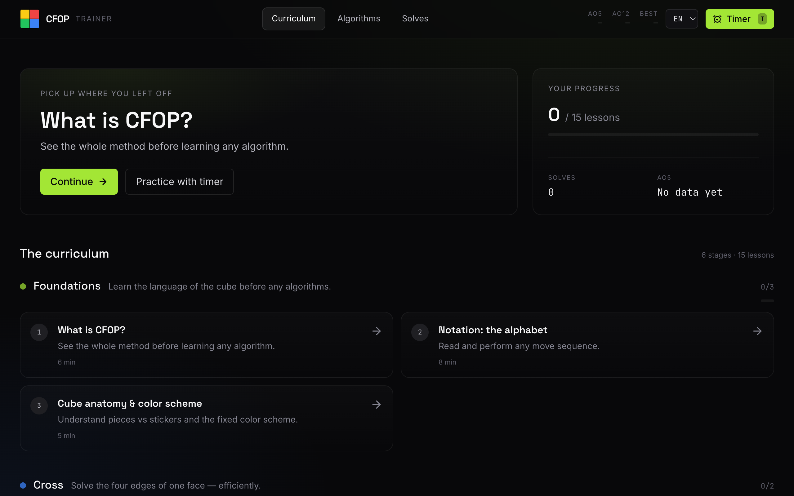
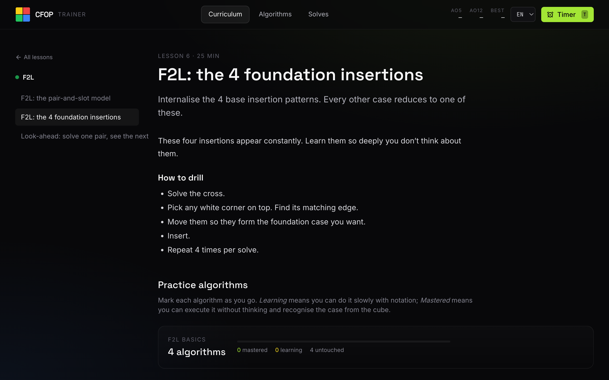

CFOP is the method most speedcubers use. The trainer takes you through 15 lessons, from notation to full OLL and PLL. Each algorithm has a diagram and a mastery tracker, and a timer keeps your averages. Everything stays in the browser, no account needed.

