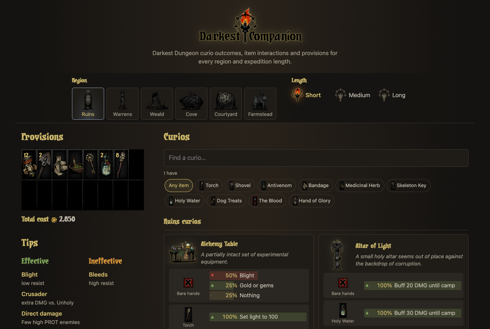
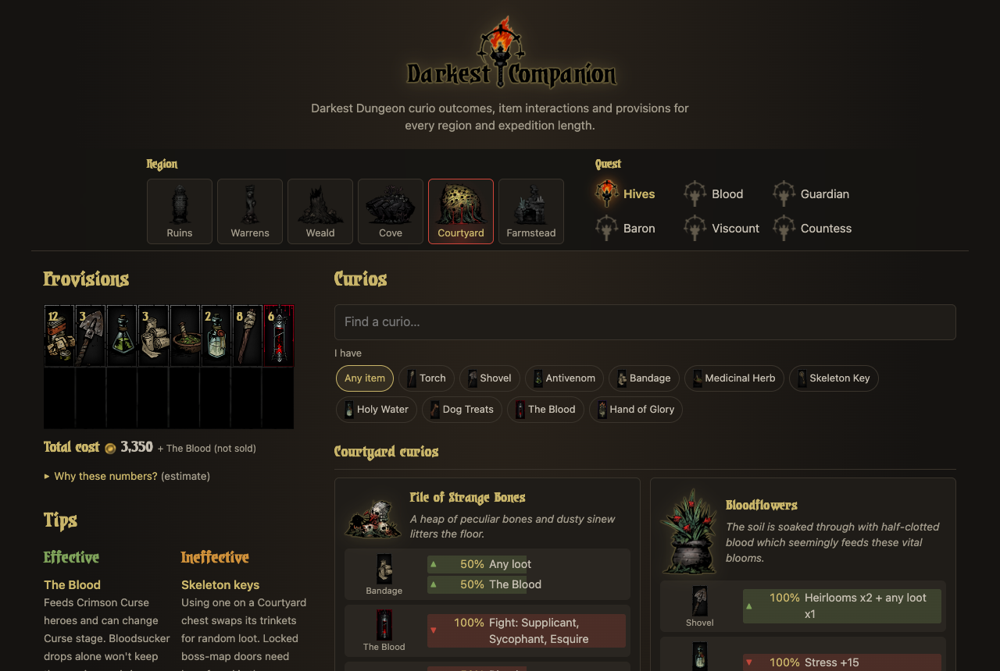

My oldest side project, and still my most visited page.

I built the first version in 2016, while playing way too much Darkest Dungeon: which item to use on which curio, and how many torches to pack for a medium Weald run. It was React 0.14 and Redux, and people kept using it for years without me touching it.

In 2026 I rebuilt it from scratch as a static Astro site, about 11 KB gzipped and mobile-first. Saved choices from the old version carry over.

What's new:

- The DLC regions: the Courtyard (The Crimson Court) and the Farmstead (The Color of Madness), with suggested loadouts per Courtyard quest and Farmstead mode.
- Special and quest curios, and 19 data errors fixed against the Darkest Dungeon Wiki.
- Curio search, and an "I have…" filter that shows where an item is useful.
- One page per region, each with its own share card.

The repo has a [RECIPE.md](https://github.com/ArnaudRinquin/darkest-companion/blob/master/RECIPE.md) if you want to build your own.

Fan project, not affiliated with Red Hook Studios. Game art © Red Hook Studios.
