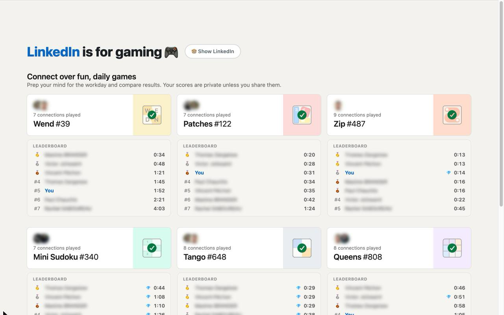
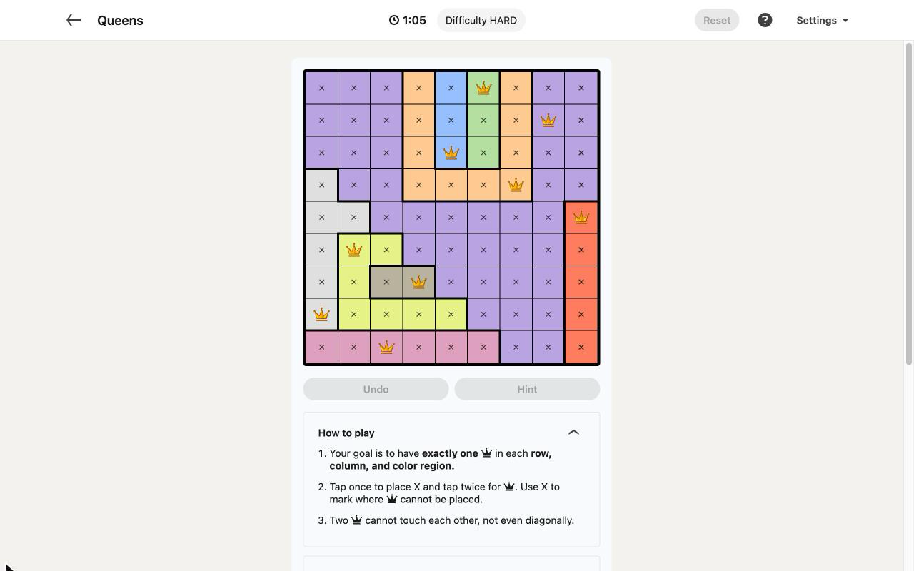
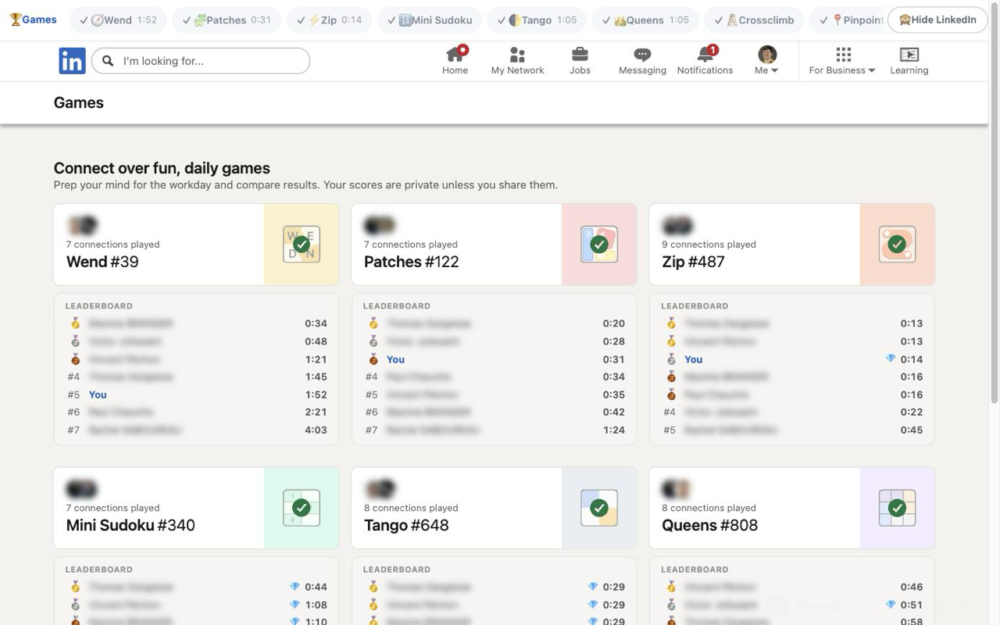

Every LinkedIn page redirects straight to the daily puzzles, with full connection leaderboards under each game. Free, open source, zero data collected.

Backstory in the [launch post](/blog/i-built-a-chrome-extension-that-deletes-linkedin-except-the-games/).

