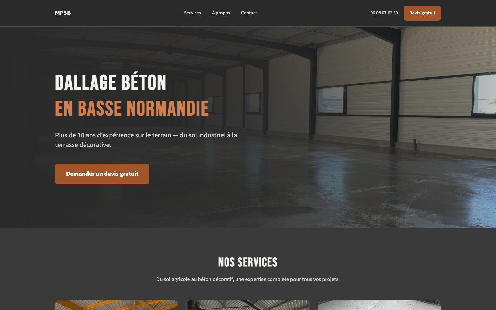
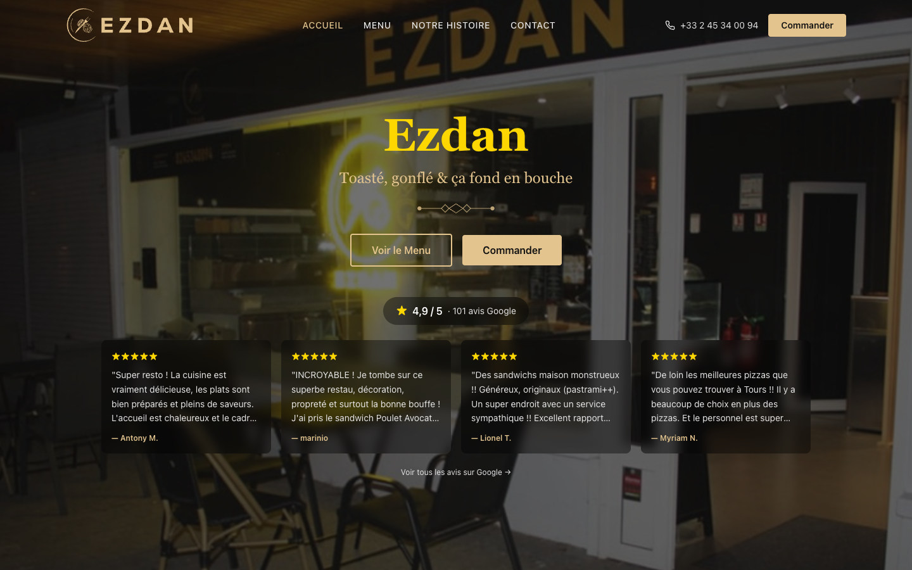
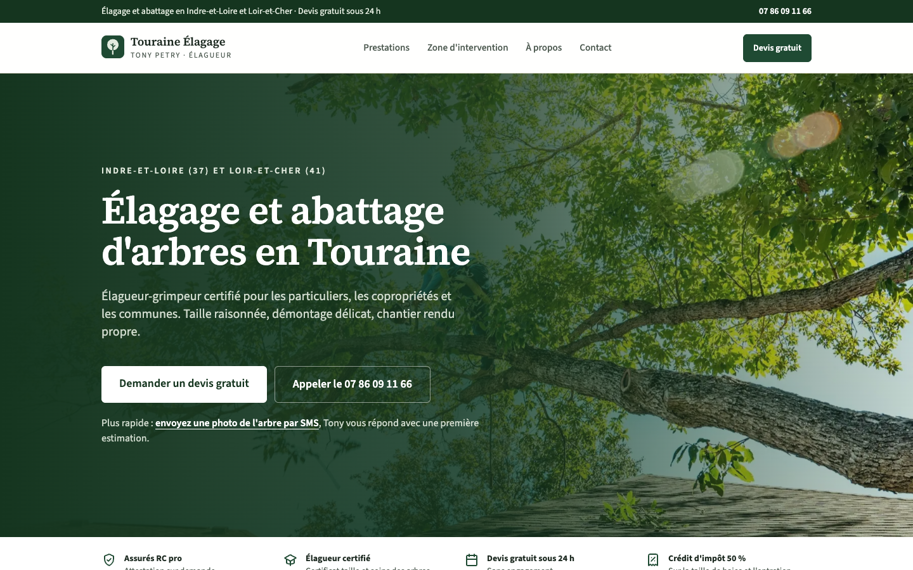
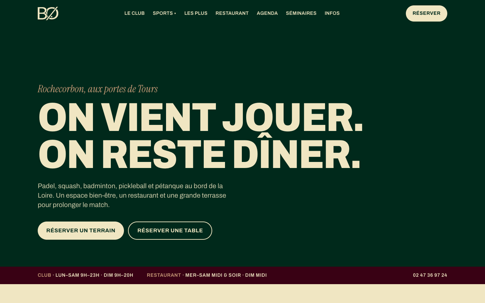

Now and then I build a website for free for someone who needs one and can't easily get it otherwise. They're small static sites: fast, cheap to host and easy to maintain.

## [MPSB](https://mpsolsbetons.fr)

My in-laws' concrete flooring business in Normandy.

## [Ezdan](https://ezdan.fr)

My favourite pizza place in Tours.

## [Touraine Élagage](https://touraine-elagage.fr)

A tree surgeon who had been scammed by a previous web agency.

## [BØ Sports Social Club](https://www.bo-club.fr)

My squash club.

