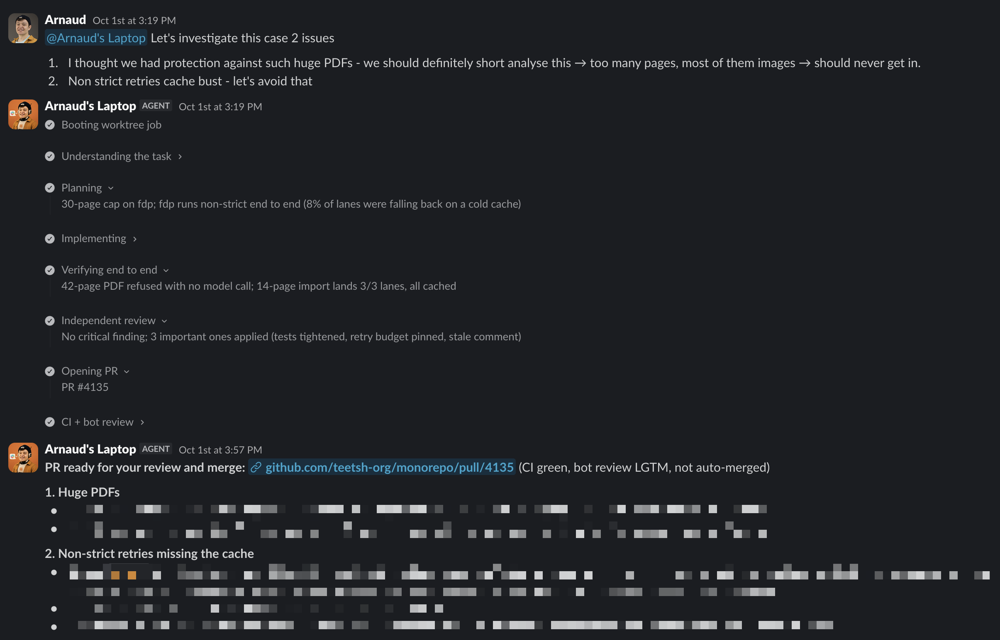

One long-lived local process with three jobs: it listens for Slack `@mention`s, serves an HTTP MCP endpoint that Claude Code worktree jobs call to drive Slack's native streaming messages, and shows status in the macOS menu bar.

The thread is the correlation key, and state is snapshotted to disk, so restarting the bridge doesn't interrupt running jobs.

