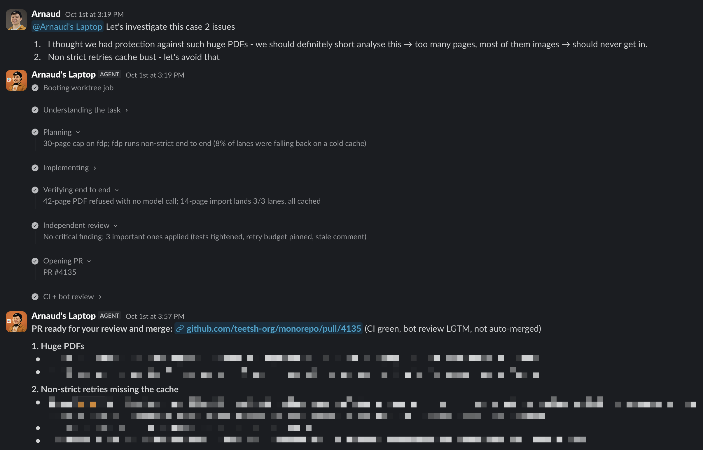

Formerly `slack-to-laptop`. One long-lived local process with three jobs: it listens for Slack `@mention`s, serves an HTTP MCP endpoint that Claude Code worktree jobs call to drive Slack's native streaming messages, and shows status in the macOS menu bar.

The thread is the correlation key, and state is snapshotted to disk, so restarting the bridge doesn't interrupt running jobs.

Linear is a second front door. The bridge is installed there as an agent: assign it an issue, mention it, or start a project, and it opens a worktree with a Claude session. One Linear project is one worktree and one session, so every issue and reply in that project reaches the same Claude. The session writes back through the same MCP endpoint: progress on the issue thread, new issues, status changes, project updates. It never holds the Linear token.

Only one path is public, the signed webhook. Everything else stays on localhost.
