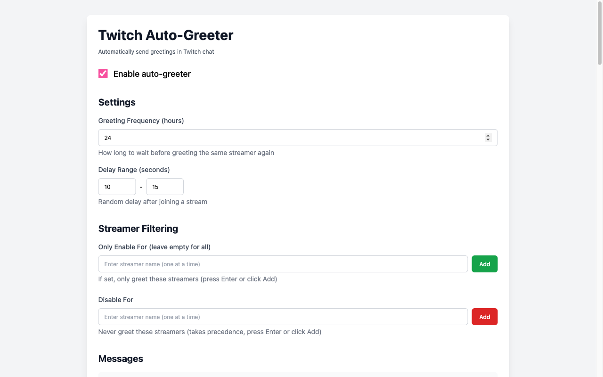
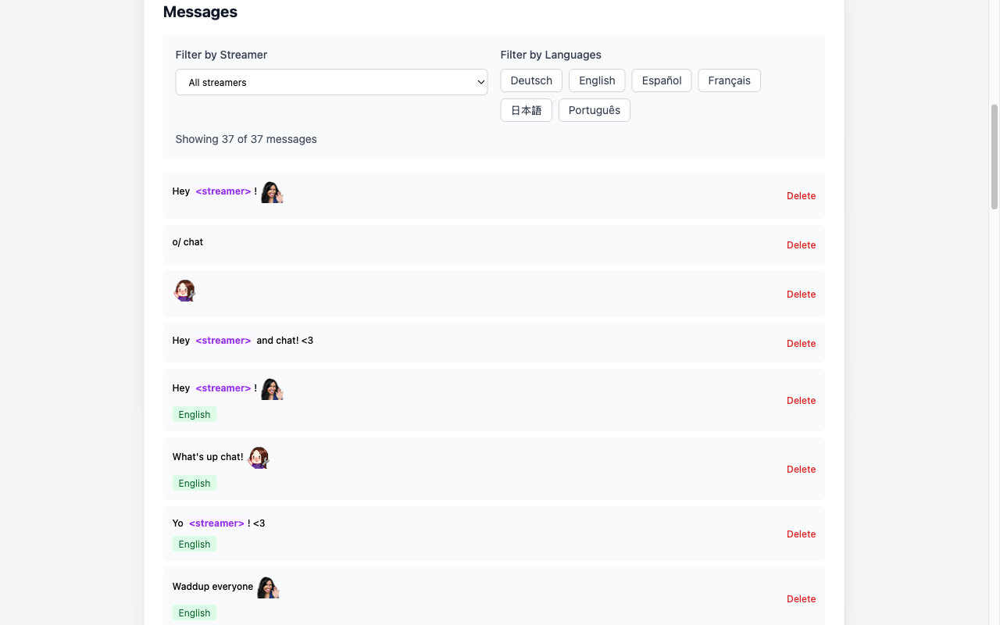
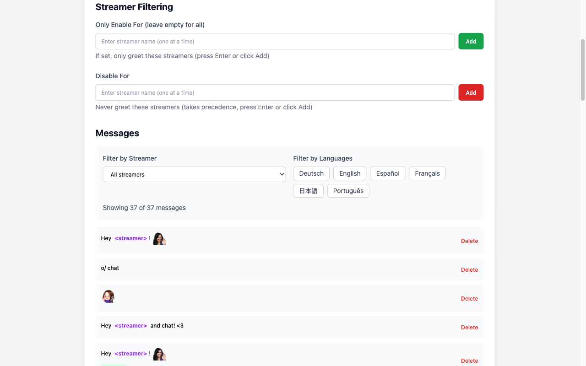
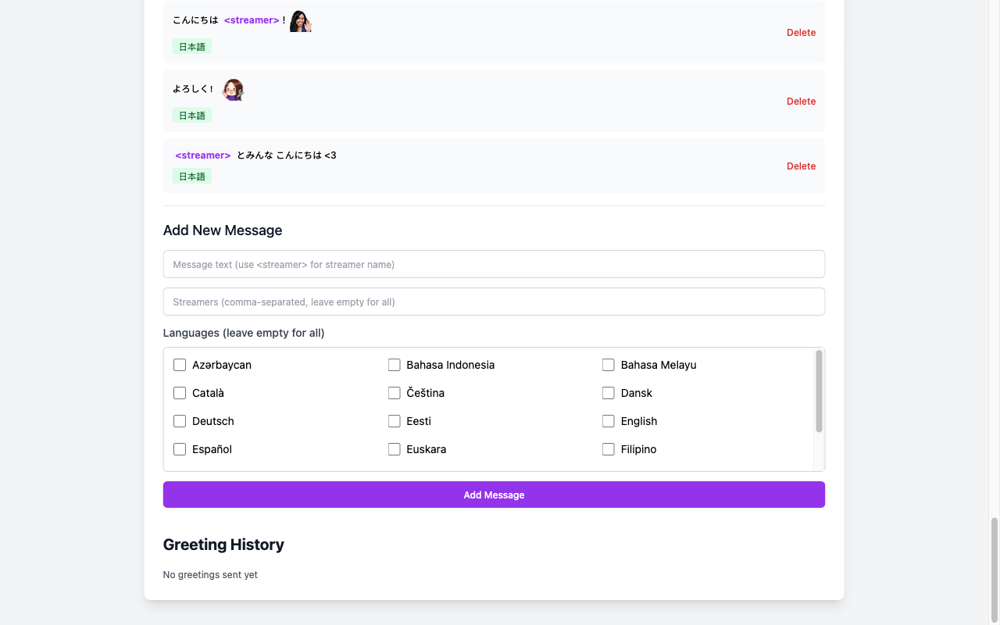

Twitch started counting only viewers who speak in chat. This extension sends one greeting per streamer per day, in the stream's language, with emote support and per-streamer rules. All data stays local.

Fully vibe-coded with Claude Code: [the story](/blog/i-finally-shipped-a-side-project-by-vibe-coding-it/).

